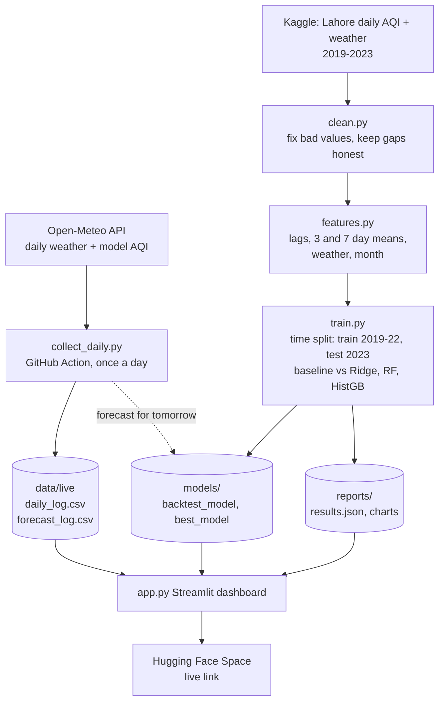

# SmogSense: next-day air quality forecast for Lahore

Predicts tomorrow's AQI from today's AQI, the last few days, and today's weather.
Beats the "tomorrow equals today" guess on the 2023 test, with a smaller margin in winter than overall (see Results).

## Architecture



## Run it

```bash
pip install -r requirements.txt
python src/clean.py         # step 1: clean the raw file
cd src && python train.py   # step 2: train, compare, save model and reports
cd .. && python tests/test_pipeline.py
python -m streamlit run app.py
```

The dashboard has a dark navy and cyan theme, responsive sidebar navigation,
an AQI status gauge, historical trend exploration, an honest next-day forecast
availability view, a what-if model simulator, held-out backtest exploration,
interactive model-performance and feature-importance charts, collected data,
and project background. The charts use Altair, which is included with
Streamlit; no extra chart dependencies are required.

## Rules the code follows

- Every feature uses only information known at the end of day t. The target is the AQI of day t+1. A test checks that changing a future day never changes an earlier feature.
- The split is by time. Train on 2019 to Dec 2022, test on 2023. The model is chosen on 2022 validation data, never on the test set.
- Missing AQI days are never filled. Impossible sensor values (wind up to 242 mph, pressure 0.0, temperature 196°F) are set to missing and reported in `reports/cleaning_report.json`.

## Results (2023 test, 301 days)

| | Average error, all days | Average error, winter days* |
|---|---|---|
| Tomorrow = today | 29.2 | 45.9 |
| Ridge | 25.6 | 41.8 |
| **RandomForest (chosen)** | **26.3** | **41.6** |
| HistGradientBoosting | 26.5 | 43.3 |

\*Winter test days are Jan, Feb and Nov 2023 only (74 days). The data ends on 30 Nov 2023, so December, the worst month, is not tested.

Improvement of the chosen model over the baseline, 95% range in AQI points: all days **0.9 to 5.1** (real but small), winter days **-2.4 to 11.0** (includes zero, so **not proven** for winter).
Ridge, a very simple model, does about as well as the Random Forest. The extra model complexity buys almost nothing here.

## Limits

- Only 1,423 days of AQI, with 221 missing (115 in 2022 alone).
- No emission data (vehicles, factories, brick kilns, crop burning). The model can show what it used, not what causes smog.
- The historical dataset covers 1 June 2019 through 30 November 2023. The dashboard never labels those records as current live readings.
- Collected AQI in `data/live/` comes from Open-Meteo's computer-model estimate, not the monitor behind the historical training data. The dashboard shows these collected records and their scores separately; a fresh checkout may have no live logs.
- The what-if tab uses a tree model, so responses move in steps and go flat at extreme values. Read it as a rough guide.

## Deploy

1. Push this folder to a GitHub repo. The Action in `.github/workflows/daily_collect.yml` then collects data daily.
2. Create a Hugging Face Space (type Streamlit), connect it to the repo or upload the folder. The front matter above is already set for Spaces.
3. Open the live link on a phone and test every tab.
"# SMOGSENSE" 
